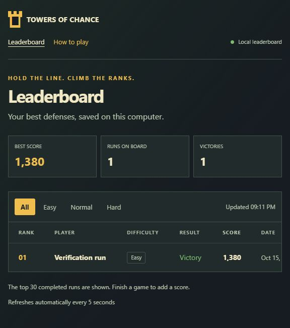

# Towers of Chance

## Save progress and local leaderboard

Double-click **run.bat** to play. The game automatically saves your current run every 2 seconds, when a wave changes, and when you return to the menu or close the window. Choose **Continue saved run** to resume with your towers, upgrades, coins, lives, chance cards, and current wave restored. A continued game starts paused; press **P** to play.

There is one saved run on this computer. **New game / Enter** starts a fresh run and replaces it. Finishing a game clears that run and sends its result to the local server once. The result screen reports whether the server saved it. If the server is unavailable, the game stays playable.

Click **Leaderboard website** in the game to open the HTML leaderboard, normally at **http://127.0.0.1:8000/**. It shows real results from SQLite, lets you filter by difficulty, and refreshes every 5 seconds. If that port is busy, the game uses another available local port. The website stays available while the game is running.

To open the server without the game, double-click **run_leaderboard.bat**. Keep its window open while using the website; press **Ctrl+C** to stop it. Both launchers use the same database. The game also starts its own local server automatically, so normal play needs just **run.bat**.

Unfinished progress lives in `%LOCALAPPDATA%\TowersOfChance\progress.json`. Completed results live in `%LOCALAPPDATA%\TowersOfChance\scores.db`. Existing results from the older `scores.json` are imported once. The database and personal saves stay out of Git. Python 3.10+ is required; `run.bat` installs Pygame, FastAPI, Uvicorn and Jinja2 on first launch.

## Local server and API

The game sends scores over HTTP to the server. The server writes SQLite and renders the Jinja HTML page; the browser reads scores from the same server.

| Address | Purpose |
| --- | --- |
| `http://127.0.0.1:8000/` | Live HTML leaderboard |
| `http://127.0.0.1:8000/static/rules.html` | Game rules |
| `http://127.0.0.1:8000/docs` | Interactive API documentation |
| `POST /scores` | Save a result, HTTP 201 on creation |
| `GET /scores/top` | Highest scores |
| `GET /players/{name}/stats` | Player games, best score, average and wins |
| `GET /api/scores` | Live leaderboard JSON |

Example score body: `{"player":"Player","score":120}`. The game also sends difficulty, level, victory/defeat and a run ID. Repeating the same run ID returns the existing result instead of creating a duplicate. Its HTTP requests time out after 3 seconds.

For separate terminals, run these from the project folder after the first setup:

```powershell
# Terminal 1: local API and website
.\.venv\Scripts\python.exe -m client.leaderboard
# Terminal 2: game
.\.venv\Scripts\python.exe -m client.main
```

If both launchers are running, they share `scores.db`. The game opens the exact address of its server through **Leaderboard website**, even if it had to choose a different port.



The screenshot shows an automated verification game using an isolated test database. Your own leaderboard starts with your saved results.

Tests: `.\.venv\Scripts\python.exe -m unittest discover -s tests -v`.

Vienkārša 2D torņu aizsardzības spēle Python un Pygame ar pikseļu izskatu. Izvēlies spēlētāja vārdu, grūtību (**Easy**, **Normal** vai **Hard**) un karti (**Meadow**, **Desert** vai **Tundra**). Aizsargā bāzi un pārvari visus 9 viļņus.

## Palaišana Windows un VS Code

Atver šo mapi VS Code. Terminālī izpildi tikai:

```powershell
.\run.bat
```

Pirmajā reizē skripts pats izveido `.venv` un instalē nepieciešamās bibliotēkas. Nākamajās reizēs tas uzreiz atver spēli un lokālo serveri. Var arī divreiz uzklikšķināt uz `run.bat`.

Nepieciešams Python 3.10 vai jaunāks. VS Code izmanto Python un Python Debugger paplašinājumus; pēc pirmās palaišanas pieejama arī **F5** atkļūdošana un uzdevums **Run Towers of Chance**. Virtuālā vide nav manuāli jāaktivizē.

## Vadība

- **Kreisais klikšķis** — izvēlēties torņa veidu veikalā un novietot to brīvā laukumā, izvēlēties esošu torni, pirkt uzlabojumu vai izvēlēties efekta kartīti.
- **Labais klikšķis** — atcelt izvēli.
- **Space** — sākt nākamo vilni.
- **Auto wave** — ieslēgt vai izslēgt automātisku viļņu sākšanu.
- **P** — pauze vai turpināt.
- **R** — pēc spēles beigām sākt jaunu spēli.
- **Esc** — atgriezties galvenajā izvēlnē.
- **Apvienošana** — izvēlēties divus viena veida 3. līmeņa torņus ar vienādu uzlabojuma ceļu, lai bez maksas izveidotu vienu 4. līmeņa torni.
- **Sell** — pārdot izvēlēto torni un atgūt pusi tajā ieguldīto monētu, noapaļojot uz leju.

## Noteikumi

Bāzei ir 20 dzīvības. Katrs ienaidnieks, kas sasniedz bāzi, atņem vienu dzīvību. Ir 3 līmeņi ar 3 viļņiem katrā; torņi, monētas un atlikušās dzīvības saglabājas starp līmeņiem. Normal režīmā katra līmeņa vilnī ir attiecīgi 5, 8 un 12 ienaidnieki ar 10, 15 un 20 dzīvībām.

Easy dod 180 sākuma monētas, mazāk ienaidnieku ar 80% dzīvībām un 85% ātrumu. Normal sākas ar 150 monētām. Hard sākas ar 130 monētām, palielina ienaidnieku skaitu, dzīvības līdz 140% un ātrumu līdz 125%.

Torņi šauj automātiski. Uzvarētie ienaidnieki dod monētas jauniem torņiem un uzlabojumiem.

| Tornis | Cena | Šāviņš un īpašība |
| --- | ---: | --- |
| Basic | 50 | Lielgabala lode; līdzsvaroti bojājumi un ātrums. |
| Ice | 80 | Ledus šķemba; katrs trāpījums īslaicīgi sasaldē ienaidnieku. |
| Fire | 90 | Ugunsbumba; aizdedzina ienaidnieku, radot bojājumus laika gaitā. |
| Machine gun | 100 | Ātri lidojošas lodes; ļoti ātri šauj īsākā attālumā. |

Šāviņi redzami lido līdz ienaidniekam. Sasaldētam ienaidniekam parādās ledus pārklājums, bet degošam — liesmas.

Katram torņu veidam ir trīs uzlabojumu ceļi: bojājumi, šaušanas ātrums vai darbības rādiuss. Otrais līmenis maksā 35 monētas, trešais — 65. Pirmais uzlabojums izvēlas ceļu, ko turpmāk vairs nevar mainīt.

Pārdošanas summa ietver sākotnējo cenu un par uzlabojumiem samaksātās monētas. Basic bez uzlabojumiem atdod 25 monētas; 2. līmeņa Basic, kurā ieguldītas 85 monētas, atdod 42. Apvienota torņa vērtībā ietilpst abu sākotnējo torņu ieguldījumi.

Easy un Normal piedāvā trīs nejaušas efekta kartītes pēc kopējā 1., 4. un 7. viļņa; Hard — pēc 1. un 6. viļņa. Katrā izvēlē jāpaņem viena kartīte. Tās efekts saglabājas līdz spēles beigām. Starp pārējiem viļņiem var turpināt būvēt un uzlabot torņus.

**Auto wave** sākumā ir izslēgts; atkārtojot spēli, pēdējā izvēle saglabājas. Ieslēdzot to, nākamais vilnis sākas pēc 3 sekundēm gatavošanās režīmā, ja ir novietots vismaz viens tornis. Pauze un gaidīšana uz kartītes izvēli aptur atskaiti. Slēdža maiņa, manuāls viļņa sākums un kartītes izvēle atiestata atskaiti uz 3 sekundēm. Pārdodot visus torņus, automātika gaida, līdz novietots cits tornis.

Par uzvarētu ienaidnieku saņem 10 punktus, par pabeigtu vilni 50 un par pabeigtu līmeni 100. Punkti un monētas ir atsevišķi. Pēc uzvaras vai zaudējuma parādās rezultāta ekrāns; galvenajā izvēlnē pieejama rekordu tabula.

Spēle vienu reizi nosūta rezultātu serverim ar `POST /scores`. Serveris glabā rekordus lokāli `%LOCALAPPDATA%\TowersOfChance\scores.db`, un vietne rāda 30 labākos rezultātus. Katram ierakstam ir vārds, punkti, sasniegtais līmenis, grūtība un spēles iznākums. Ja serveris nav pieejams, spēli joprojām var spēlēt. **Continue saved run** turpina automātiski saglabāto spēli; **New game** sāk no pirmā līmeņa.

## Projekta uzbūve

- `game/` — spēles noteikumi un modelis.
- `client/` — Pygame logs, izvēlnes un lokālie rekordi.
- `client/api_client.py` — spēles HTTP savienojums ar serveri.
- `client/database.py` — SQLite rekordi un spēlētāju statistika.
- `web/templates/leaderboard.html` — Jinja rekordu tabula.
- `web/static/` — CSS un spēles noteikumu lapa.
- `run.bat` — automātiska sagatavošana un palaišana Windows.
- `run_leaderboard.bat` — rekordu vietne bez spēles palaišanas.
- `DESIGN.md` — spēles apraksts un ekrāna skice.

Krāsas var mainīt pie `# --- Krasa ---`, automātisko viļņu pauzi — pie `# --- Vilnu pauze ---` failā `client/main.py`. Torņu cenas un spēles noteikumi atrodas `game/model.py`.

Projekta GitHub repozitorijs: [hubx-x/Tower-of-chance](https://github.com/hubx-x/Tower-of-chance). Lokālie rekordi un virtuālā vide netiek iekļauti Git.

Virsrakstu fonts: [VT323](https://github.com/google/fonts/tree/main/ofl/vt323), licence `assets/OFL.txt`. Pārējais teksts izmanto Windows iebūvēto Arial fontu, vismaz 20 pikseļu izmērā; tam nav vajadzīgs papildu fonta fails.

Spēlei nav vajadzīgs Pylink vai Pylint. Lokālais FastAPI serveris tiek palaists automātiski.
